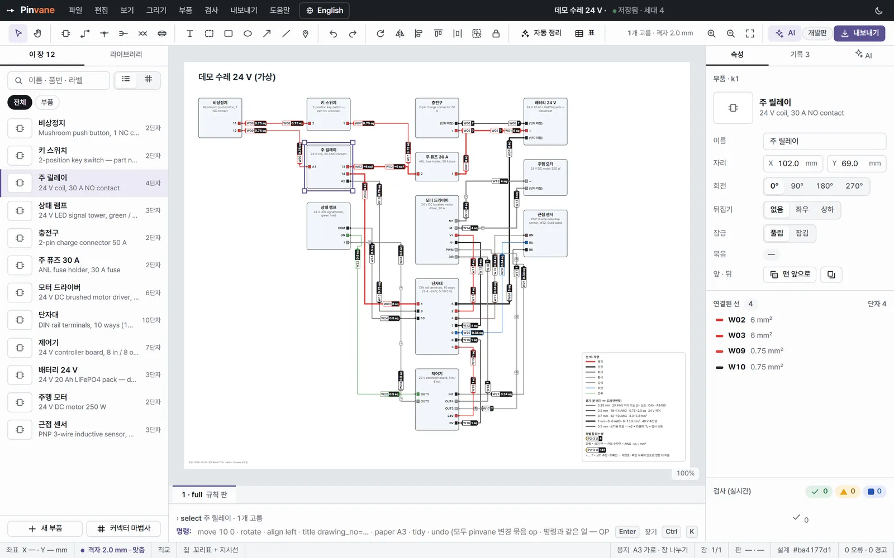

  <picture>
    <source media="(prefers-color-scheme: dark)" srcset="docs/images/logo-for-dark.png">
    
  </picture>

# Pinvane(핀베인)

**배선도를 그려 본 적 없는 사람도 AI와 함께, 현장 작업자가 쓸 배선도를 만들 수 있게 — 그것을 위해 만드는 도구입니다.**

[English](README.md) · 홈페이지: https://pinvane.com/ko/ · 문의: support@pinvane.com

이것이 목표입니다. 지금 Pinvane은 부품 목록과 결선표를 도면과 작업표 **초안**으로 옮기고, 미정 · 추정 정보를 확인 목록과 연결하며, 모든 것을 사람이 화면에서 고칠 수 있게 합니다. 길이 · 접점 · 단자는 여전히 사람이 정해야 합니다: 작업자가 Pinvane의 표로 실제 장비를 배선해 본 시험은 아직 없고, 시험 설계 여섯은 가상입니다([알려진 한계](CHANGELOG.ko.md#알려진-한계와-문제) · [시험 결과](https://pinvane.com/ko/evidence/)).

> **Pinvane 1.0.1 출시** — Windows 10 · 11, 64비트. https://pinvane.com/ko/download/ 나 이 저장소의 [Releases](https://github.com/pinvane-app/pinvane/releases/tag/v1.0.1)에서 `Pinvane-1.0.1-setup.exe`를 내려받고, 실행하기 전에 SHA-256을 확인하세요 — [시작하기 → 설치](docs/ko/getting-started.md#설치). 14일 동안 모든 기능을 무료로 써 볼 수 있습니다 — 카드 없이. 요금: https://pinvane.com/ko/pricing/ (이용권은 판매가 열리면 살 수 있습니다).

## 이렇게 씁니다

1. **자료를 AI에게 건넵니다** — 부품 목록 · 결선표 · 메모. 빈 곳이 있어도 됩니다.
2. **AI가 Pinvane으로 초안을 그립니다** — Pinvane의 로컬 MCP 서버(또는 명령줄)로 도면과 작업표 초안을 만듭니다. 자료에 없는 값은 *미정*으로 남아 확인 목록의 질문이 됩니다.
3. **사람이 확인하고 고칩니다** — 확인 목록에 답하고, 편집기에서 살펴본 뒤 내보냅니다.

Pinvane은 AI가 쓰기 좋게 만든 도구입니다. AI는 화면을 눌러 가며 그리지 않고 그리기 · 고치기 · 검사 · 내보내기를 하고, 정리된 답을 받습니다. AI 없이 사람이 손으로 모두 그릴 수도 있습니다.

## 사용 방법

| | |
|---|---|
| [시작하기](docs/ko/getting-started.md) | 필요한 것 · 설치와 SHA-256 확인 · 첫 프로젝트 · 손으로 그리기 |
| [AI 앱 연결](docs/ko/ai-apps.md) | 로컬 MCP 서버 · 내가 받아들이는 제안 · AI 창 |
| [명령줄](docs/ko/command-line.md) | `new` · `import-table` · `check` · `export` 와 데모 |
| [확인 목록과 내보내기](docs/ko/check-list-and-outputs.md) | 미정 값이 질문이 되는 방식 · 내보낼 수 있는 것 |
| [도움 · 업데이트 · 문제 알리기](docs/ko/help.md) | 자주 묻는 것 · 업데이트 확인 · 문제 알리기 · 연락 |
| [바뀐 내용](CHANGELOG.ko.md) | 새것부터 · 알려진 문제 |

가상 데모 프로젝트(24 V 수레: 부품 12 · 선 24)는 [examples/demo-cart-24v](examples/demo-cart-24v)에 있습니다.

## 질문과 문제 알리기

- **공개 질문 · 문제 알리기:** 이 저장소의 [이슈](https://github.com/pinvane-app/pinvane/issues/new/choose).
- **공개하고 싶지 않은 일**(사용권 · 결제 등): support@pinvane.com.
- **보안 문제:** 비공개로 알려 주세요 — [SECURITY.md](https://github.com/pinvane-app/.github/blob/main/SECURITY.md). 공개 이슈로 올리지 마세요.

**도면 · 프로젝트 파일 · 고객 이름 · 파일 경로는 절대 올리지 마세요.** 우리는 도면이 필요 없습니다. 문제를 보여 줘야 하면 부품 몇 개만 넣은 작은 견본 프로젝트로 같은 일이 일어나게 해 주세요.

Pinvane에는 오류 자동 보고가 없습니다. Pinvane이 짧은 문제 보고서를 쓰고, 사용자가 읽어 본 뒤 직접 보냅니다 — [도움](docs/ko/help.md#문제-알리기).

## 이 저장소

사용 방법(영어 · 한국어) · 바뀐 내용 · 릴리스 · 이슈를 둡니다. Pinvane 소스 코드는 들어 있지 않습니다.

Pinvane은 가온제이에이치(GAONJH)가 만듭니다.
