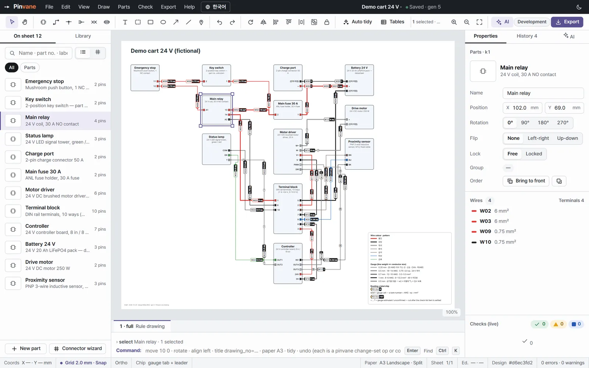

  <picture>
    <source media="(prefers-color-scheme: dark)" srcset="docs/images/logo-for-dark.png">
    
  </picture>

# Pinvane

**Built for people who have never drawn a wiring diagram — so that, with an AI, they can make one a technician can work from.**

[한국어](README.ko.md) · Website: https://pinvane.com · Contact: support@pinvane.com

That is the goal. Today Pinvane makes a **draft** diagram and work tables, links what is still undecided to a check list, and lets people fix everything by hand. Lengths, contacts and terminals still need people: no worker has wired a real machine from Pinvane's tables yet, and our six test designs are fictional ([known limits](CHANGELOG.md#known-limits-and-issues), [test results](https://pinvane.com/evidence/)).

> **Pinvane 1.0.2 is out** for Windows 10 and 11, 64-bit. Download `Pinvane-1.0.2-setup.exe` from https://pinvane.com/download/ or this repository's [Releases](https://github.com/pinvane-app/pinvane/releases/tag/v1.0.2) page, and check its SHA-256 before you run it — see [Getting started → Install](docs/en/getting-started.md#install). Try every feature free for 14 days, no card needed. Plans: https://pinvane.com/pricing/ (passes can be bought once sales open).

## How it works

1. **Give the AI your material** — a parts list, a connection table and notes.
2. **The AI draws with Pinvane** — through Pinvane's local MCP server (or the command line), it lays out a draft diagram and work tables. Values your material does not give stay *not set* and become questions on the check list.
3. **People check and fix** — answer the check list, review the drawing in the editor, then export.

Pinvane is made for AI to use: an AI can draw, change, check and export without clicking through screens, and gets structured answers back. A person can also draw everything by hand without any AI.

## Read the guide

| | |
|---|---|
| [Getting started](docs/en/getting-started.md) | What you need, install and SHA-256 check, the first project, drawing by hand |
| [Connect your AI app](docs/en/ai-apps.md) | Local MCP server, proposals you accept, the AI window |
| [Command line](docs/en/command-line.md) | `new` · `import-table` · `check` · `export` and the demo |
| [Check list and outputs](docs/en/check-list-and-outputs.md) | How undecided values become questions; what you can export |
| [Help, updates and problem reports](docs/en/help.md) | FAQ, update check, reporting a problem, contact |
| [What's new](CHANGELOG.md) | Changes, newest first, and known issues |

A fictional demo project (a 24 V cart: 12 parts, 24 wires) is in [examples/demo-cart-24v](examples/demo-cart-24v).

## Questions and problem reports

- **Public questions and problem reports:** [Issues](https://github.com/pinvane-app/pinvane/issues/new/choose) in this repository.
- **Private matters** (license, payment, anything you do not want public): support@pinvane.com.
- **Security problems:** please report privately — see [SECURITY.md](https://github.com/pinvane-app/.github/blob/main/SECURITY.md). Do not open a public issue.

**Please never attach drawings, project files, customer names or file paths.** We do not need them. If a problem must be shown, make a small sample project with a few parts that shows the same thing.

Pinvane has no automatic error reporting. Pinvane can write a short problem report that you read and send yourself — see [Help](docs/en/help.md#report-a-problem).

## This repository

This repository holds the user guide (English and Korean), release notes, releases and issues. It does not contain Pinvane's source code.

Pinvane is made by GAONJH (가온제이에이치).
