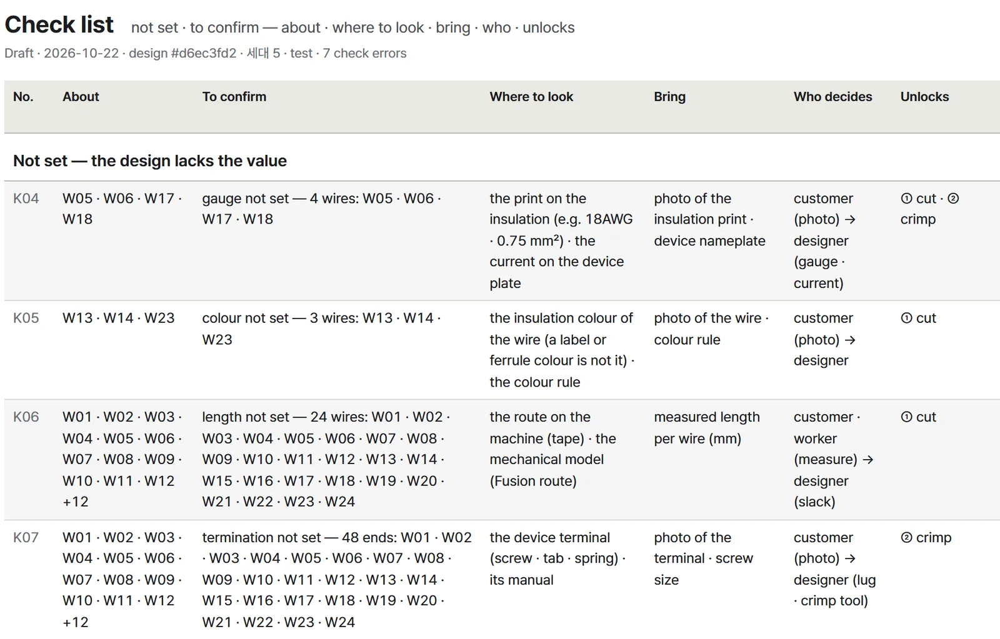
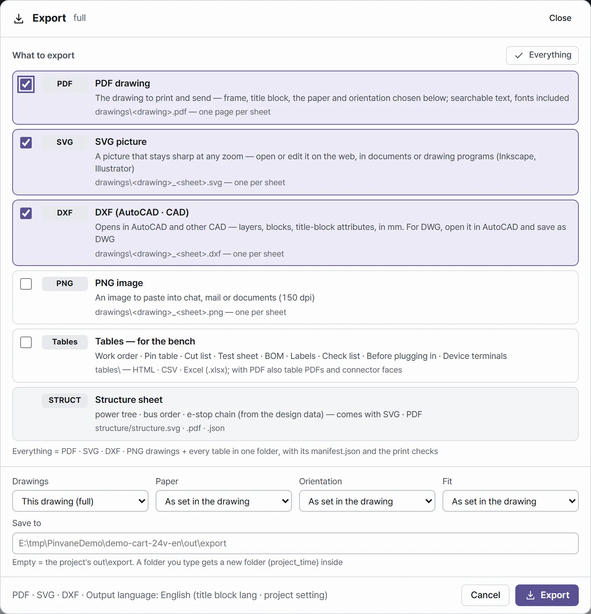

# Check list and outputs

[한국어](../ko/check-list-and-outputs.md) · [Guide home](../../README.md)

## Undecided stays visible

When you import tables or an AI adds wires, a value your material does not give stays **not set** and becomes a question. A wire drawn by hand starts with no colour or gauge too; reusing your last values is a switch you turn on.

Each check-list row is asked in plain words. A row from the fictional demo:

| Column | Example (demo row K04) |
|---|---|
| To confirm | gauge not set — 4 wires: W05 · W06 · W17 · W18 |
| Where to look | the print on the insulation (e.g. 18AWG · 0.75 mm²) · the current on the device plate |
| Bring | photo of the insulation print · device nameplate |
| Who decides | customer (photo) → designer (gauge · current) |
| Unlocks | ① cut · ② crimp |

The work a row can unlock: cut, crimp, label, plug in, test.

- **On the work rows** — cut-list, pin-table and test-sheet rows show their evidence state and related check numbers. Connections marked "different" are held: confirm before power.
- **Evidence grades** — words in your material such as "estimated", "from the drawing" or "unknown" are kept as evidence grades with the original text, to help you check.
- To answer a question, enter the value and its source (in the editor, or ask the AI), then export again: the tables are updated.

## Outputs

From one design, a draft diagram and work tables:

| Output | Formats | For |
|---|---|---|
| Wiring diagram | PDF · SVG · PNG · DXF | Print and sharing: paper picked automatically (or A4–A0, custom), the wiring fills the page, thick border, info column. For CAD, the drawing format: ISO frame, editable title block, DXF |
| Pin table · cut list | HTML · CSV · Excel · PDF | Cutting and crimping; rows show their evidence state and related check numbers |
| Label list | HTML · CSV · Excel · PDF | Label text, count, gauge, colour and where each label goes |
| Work order · pre-plug check · test sheet | HTML · CSV · Excel · PDF | The order of work, what to check before plugging in, how each test passes (test rows also show check numbers) |
| Check list · parts list | HTML · CSV · Excel · PDF | What is still undecided and who decides; what to buy |

- Table PDFs are made when PDF is selected. A table with nothing to list can be empty.
- The export runs the drawing and design checks and records the results with the files.
- Wire colours are also shown as line patterns.

**Drafts until people confirm them.** Undecided production information — lengths, contacts, the real terminals — is confirmed and entered by you and your designer. No worker has wired a real machine from Pinvane's tables yet, and our six test designs are fictional ([test results and limits](https://pinvane.com/evidence/#e3)).
