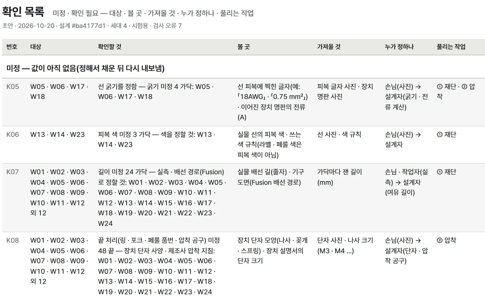
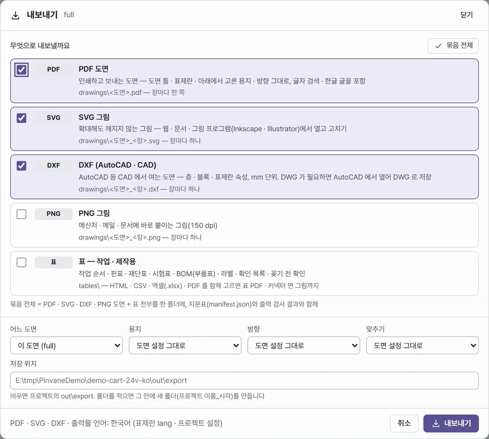

# 확인 목록과 내보내기

[English](../en/check-list-and-outputs.md) · [사용 방법 처음](../../README.ko.md)

## 정해지지 않은 것은 보이게

부품 목록 · 결선표를 가져오거나 AI가 선을 넣을 때, 자료에 없는 값은 **미정**으로 남아 질문이 됩니다. 손으로 그린 새 선도 사람이 정하기 전까지 색 · 굵기가 비어 있습니다. 마지막 값 이어 쓰기는 사람이 켜는 선택입니다.

확인 목록의 줄은 쉬운 말로 묻습니다. 가상 데모의 한 줄:

| 칸 | 예(데모 K05 줄) |
|---|---|
| 확인할 것 | 선 굵기를 정함 — 굵기 미정 4 가닥: W05 · W06 · W17 · W18 |
| 볼 곳 | 선 피복에 찍힌 글자(예: 「18AWG」 · 「0.75 mm²」) · 이어진 장치 명판의 전류(A) |
| 가져올 것 | 피복 글자 사진 · 장치 명판 사진 |
| 누가 정하나 | 손님(사진) → 설계자(굵기 · 전류 계산) |
| 풀리는 작업 | ① 재단 · ② 압착 |

풀리는 작업은 재단 · 압착 · 라벨 · 꽂기 · 시험입니다.

- **작업 줄에도** — 재단표 · 핀표 · 시험표의 줄에 근거 상태와 관련 확인 번호가 붙습니다. 「다름」으로 표시된 연결은 보류입니다: 전원을 넣기 전에 확인하세요.
- **근거 등급** — 자료의 「추정」 · 「도면」 · 「모름」 같은 말은 원문과 함께 근거 등급으로 남아 확인을 돕습니다.
- 답하려면 값과 그 출처를 넣고(편집기에서, 또는 AI에게 부탁) 다시 내보냅니다. 표가 새로 만들어집니다.

## 나오는 것

같은 설계 자료에서 도면과 작업표 초안을 한 번에 내보냅니다.

| 출력 | 형식 | 쓰임 |
|---|---|---|
| 배선도 | PDF · SVG · PNG · DXF | 인쇄(A4~A0 · 사용자 크기) · CAD · 공유. 표제란을 고칠 수 있는 도면 틀 |
| 핀표 · 재단표 | HTML · CSV · 엑셀 · PDF | 재단과 압착 — 줄마다 근거 상태와 관련 확인 번호 |
| 라벨 목록 | HTML · CSV · 엑셀 · PDF | 라벨 글 · 매수 · 굵기 · 색 · 붙일 곳 |
| 작업 순서 · 꽂기 전 확인 · 시험표 | HTML · CSV · 엑셀 · PDF | 일의 순서 · 꽂기 전에 볼 것 · 시험마다 합격 기준(시험 줄에도 확인 번호) |
| 확인 목록 · 부품표 | HTML · CSV · 엑셀 · PDF | 아직 정해지지 않은 것과 누가 정하나 · 살 것 |

- 표 PDF 는 PDF 를 고를 때 만들어집니다. 해당하는 것이 없는 표는 비어 있을 수 있습니다.
- 내보내기는 도면 검사와 설계 검사를 돌리고 결과를 파일과 함께 기록합니다.
- 선 색은 선 무늬로도 보입니다.

**사람이 확인하기 전까지는 초안입니다.** 미정으로 남은 제작 정보 — 길이 · 접점 · 실물 단자 — 는 사용자와 설계자가 확인해 넣습니다. 작업자가 Pinvane의 표로 실제 장비를 배선해 본 시험은 아직 없고, 시험 설계 여섯은 가상입니다([시험 결과와 한계](https://pinvane.com/ko/evidence/#e3)).
